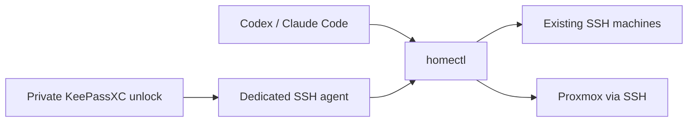

<div align="center">

# homectl

**Run your homelab from your AI coding agent. Your keys stay encrypted.**

Named machines, encrypted SSH keys and one unlock a day for Codex and Claude Code.

[](https://github.com/Hiosdra/homectl/actions/workflows/ci.yml)


[Install](#install) · [Quick start](#quick-start) · [User guide](docs/user-guide.md) · [Windows and WSL](docs/windows.md) · [Sync](docs/peer-workspace.md)

</div>

---

homectl gives your agent a safe way to look after your servers, NAS devices, printers and Proxmox nodes. It knows what each machine is for, runs commands within the access you set, and never sees your private keys.

> Check the printer's Klipper and Moonraker services before changing anything.

> Inspect the NAS disk usage and summarize what is taking space.

> Prepare a Proxmox VM plan with 4 CPUs and 8 GB RAM for me to review.

## Why homectl

- **Machines with context.** Each machine has a name, a purpose, an access tier and cautions. Your agent reads them before it acts.
- **Keys that stay encrypted.** SSH keys live in a dedicated KeePassXC database. Unlock once, and the default session lasts 24 hours.
- **Review before anything changes.** Inspect first. Destructive commands need an exact plan and your confirmation.
- **One setup on every computer.** Linux, macOS, Windows and WSL. Pair your devices and sync only what you choose, with conflicts you decide.

## See it in action

```sh
home-ctl session unlock          # once a day, in a private terminal
home-ctl hosts
home-ctl inspect lab-printer
home-ctl exec lab-printer -- uname -s
home-ctl session lock            # when you are done
```

Add `--json` to any command for scripts and agents.

## Install

You need OpenSSH and KeePassXC (its `keepassxc-cli` tool). Then choose your system:

| System | Command |
| --- | --- |
| macOS and Linux (Homebrew) | `brew tap Hiosdra/tap` then `brew install homectl` |
| Debian, Ubuntu | `sudo apt-get install ./homectl_<version>_amd64.deb` |
| Fedora, RHEL | `sudo dnf install ./homectl-<version>-1.x86_64.rpm` |
| Arch Linux | `sudo pacman -U ./homectl-<version>-1-x86_64.pkg.tar.zst` |
| Alpine Linux | `sudo apk add --allow-untrusted ./homectl_<version>_x86_64.apk` |
| Windows | Unzip `homectl-<version>-windows-x64.zip` and put `home-ctl.exe` on your PATH |
| Anything else | Download the archive for your system from [Releases](https://github.com/Hiosdra/homectl/releases/latest) |

> **Agent skills need the source checkout for now.** Packages and archives contain the `home-ctl` command (and the license), not the Codex and Claude Code skills. Those come from `home-ctl setup`, run in a checkout of this repository. Requires Bun 1.4.4 or newer:

```sh
git clone https://github.com/Hiosdra/homectl.git
cd homectl
bun install --frozen-lockfile
bun src/cli/main.ts setup
```

Keep the checkout at a stable path. `setup` links the command and the three skills, and sets up SSH aliases. Preview it first with `--dry-run`.

## Quick start

1. **Open the panel.** `home-ctl panel` opens a local workspace in your browser. Keep that terminal open while you use it.
2. **Create a vault.** In **Access**, create an encrypted vault and choose its password. It stays on this computer.
3. **Add a machine.** Create an SSH key named after the machine. Install its **public key** through your existing trusted access, and verify the host fingerprint through a trusted source. Then add the machine under **Machines**. homectl connects the key automatically.
4. **Let your agent work.** Unlock in a private terminal with `home-ctl session unlock`, then ask your agent.

For scripted setup and advanced host settings, use the [user guide](docs/user-guide.md).

## Choose how much each machine allows

| Tier | Intended use |
| --- | --- |
| `observe` | Read-only inspection with recognized commands |
| `user` | Work as the existing account, without privileged commands |
| `sudo-approved` | Exact sudo commands you allow, such as restarting a service |
| `full` | Administration and Proxmox provisioning |

Tiers guide what the agent may run. Real privileges still come from your accounts and system configuration. See [access tiers](docs/user-guide.md#access-tiers).

## Sessions that fit your day

```sh
home-ctl session configure --ttl 12h          # or: --ttl until-reboot
home-ctl session status
home-ctl session lock
```

The session lasts 24 hours from unlock by default. Unlocking again does not extend it. Locking stops new SSH logins; connections already open can finish.

## Provision a Proxmox VM

homectl uses `pvesh` over SSH to clone a cloud-init template, configure and start the VM, wait for SSH, and enroll it. Review the plan first:

```sh
home-ctl provision --file /path/vm.json --dry-run
home-ctl provision --file /path/vm.json
```

Start from [vm.example.json](examples/vm.example.json). The [walkthrough](docs/user-guide.md#proxmox-vm-provisioning-over-ssh) covers the template and network setup.

## Sync your computers

Pair two devices with a one-time code and a matching phrase. Then review the changes before anything is applied. Each device keeps its own vault password. Details are in the [sync guide](docs/peer-workspace.md).

## How it works



Your agent and homectl run on one machine. Managed machines keep their existing accounts. Keys are encrypted at rest and loaded into a separate SSH agent for the session. Inventory holds references and host details, never key material.

## Honest limits

- **Confirmation is a safeguard, not a sandbox.** Your approval keeps changes deliberate. It does not isolate the agent or remove privileges an account already has.
- **An unlocked session is open to your user account.** Other programs running as you can use the unlocked SSH agent. Lock when you finish.
- **Early project.** VM image import, DHCP discovery and cross-node provisioning are not built yet. Read the [credential model](docs/user-guide.md#configuration-and-credential-storage) and [verification status](docs/user-guide.md#verification-status) before you choose access tiers.

## More

- [User guide](docs/user-guide.md): install details, access tiers, provisioning, troubleshooting
- [Windows and WSL](docs/windows.md): PowerShell, CMD, Git Bash, services
- [Sync and pairing](docs/peer-workspace.md): two computers, one reviewed sync
- [Inventory example](examples/inventory.example.yaml) · [Architecture](docs/architecture.md)
- Agent skills: [Operate](skills/homelab/SKILL.md) · [Set up](skills/homelab-setup/SKILL.md) · [Enroll](skills/homelab-enroll/SKILL.md)
- Command help: `home-ctl --help`, or `home-ctl <command> --help`

MIT License. See [LICENSE](LICENSE).
